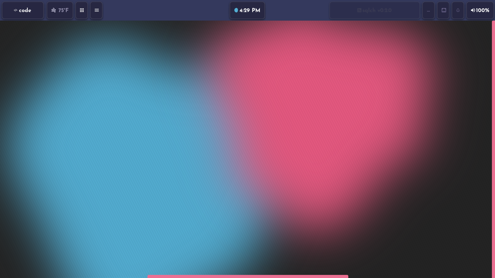
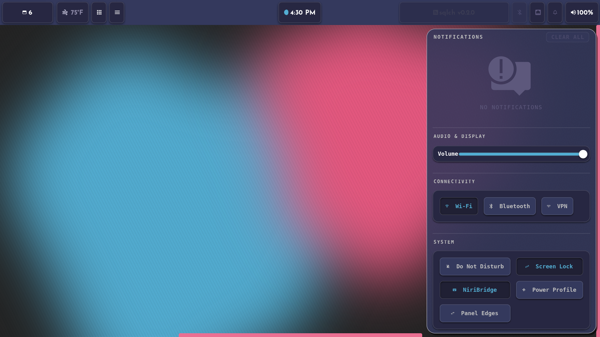
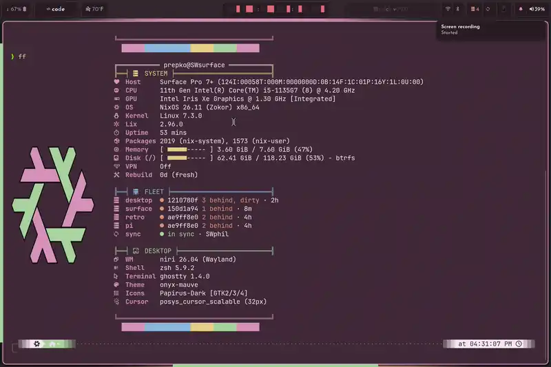
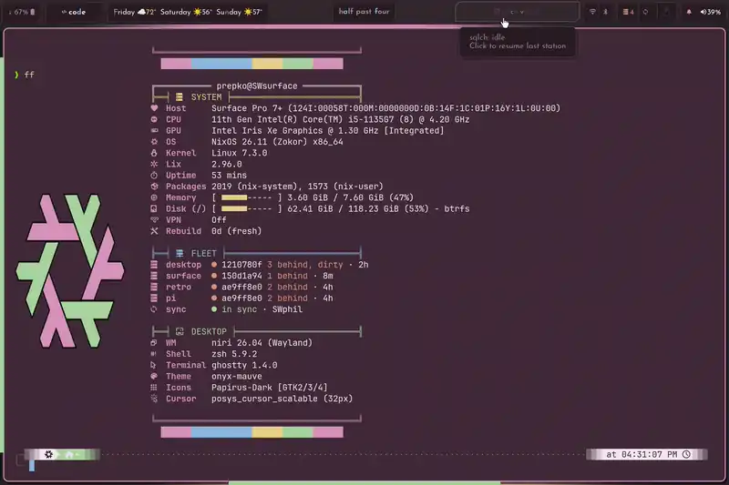
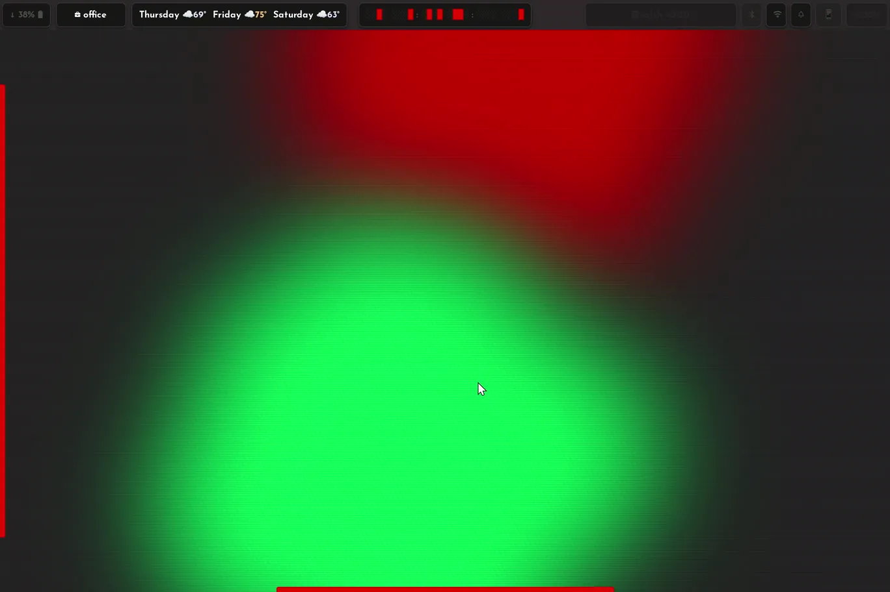

# NixOS Configuration

This repository contains my NixOS and Home Manager configuration for four machines:

- Desktop
- Surface Pro 7+
- Thin client on the TV
- Raspberry Pi

It uses the [niri](https://github.com/niri-wm/niri) compositor, a theme engine that recolours the whole desktop live, a tablet mode that follows the Surface's keyboard, and some fleet tooling that keeps the machines in step.

> [!NOTE]
> This is tuned to my hardware and habits. Read it and borrow from it, but expect me to break things regularly and fix them a day or two later. It succeeds [dotfiles](https://github.com/SW-philip/dotfiles), which I no longer update.

## Screenshots

### Desktop





### Panel tour

Waybar, its tooltips and `ff`, the fleet-aware fetch.



### sqlch and Spotify windows

Draggable, magnetic layer-shell windows for [sqlch](https://github.com/SW-philip/sqlch), my internet radio player.



### Tablet mode

Detaching the Surface keyboard switches the desktop into tablet mode. The ledger bar grows, and the wing and ledger menus get pull-tabs. Squeekboard opens when you tap a text field in a browser, or anywhere with a three-finger tap.



## Details

### General Overview

Every colour comes from a palette file. `scripts/auto-theme.py` generates a palette from a few seed colours, and `drmis` switches the whole desktop to one live. There are 42 palettes in `themes/` (22 dark, 20 light). Each has an SVG wallpaper, but most of the PNG ones aren't in the repo.

The desktop is niri with Waybar, eww, swaync, fuzzel and ghostty. eww draws the ledger, the wing, the notification center and the tablet UI. hyprlock is still the lock screen, and the login greeter is a small GTK app in `pkgs/greeter`.

Desktop and Surface use [Lix](https://lix.systems), lanzaboote secure boot, LUKS, btrfs subvolumes and impermanence. Secrets are sops-nix with age. Tailscale connects all the machines.

The hosts are on different channels on purpose, so a shared module can't assume either one's option shapes.

### Host Configurations

#### Desktop

i5-9600K, GTX 1660, two FHD monitors on DP (sometimes a TV over HDMI). `nixpkgs-unstable`.

- Sunshine game streaming to `retro`
- Emulation: Pegasus, RetroArch cores and standalone emulators (`home/emulation`)
- Shares its keyboard and mouse with the Surface over the network (`pkgs/niri-bridge`)
- Does the Surface's builds and the nightly fleet deploy

#### Surface

Surface Pro 7+ with the linux-surface kernel and 8 GB of RAM. `nixpkgs-unstable`.

- Tablet mode and an on-screen keyboard
- Offloads builds to the desktop, because 8 GB and a kernel build don't mix
- A locked-down kid account with its own touch-friendly dashboard
- Lighter emulation set (`home/emulation-light`)

#### Retro

Dell Inspiron 5579 on the TV, a Moonlight kiosk streaming games from the desktop (`hosts/retro/kiosk.nix`). `nixos-26.05`, lanzaboote and TPM2 LUKS.

#### Pi

Raspberry Pi 3B+, aarch64. A headless git hub that mirrors my private repo. `nixos-26.05`.

### Fleet tooling

- `tree-sync` keeps the working tree in step across machines through the Pi
- `fleet-status` records what each host is running and how far behind it is
- `quivr` shows live per-host stats in the terminal
- `ff` and a Waybar module read the same snapshot
- `goodnight` runs the nightly deploy, upkeep, reboot and backup batch

`commands` prints every tool this repo installs, with a line each.

### Keybindings

`Mod` is the Super key. `Mod+Slash` shows the full list.

- `Mod+Return`: terminal
- `Mod+Space`: launcher
- `Mod+S`: settings (network, Bluetooth, audio, display)
- `Mod+B`: notification center
- `Mod+O`: overview of every workspace
- `Mod+H` / `Mod+L`: focus the column to the left / right
- `Mod+1`..`5`: workspace (add `Shift` to send the window there)
- `Mod+Ctrl+Shift+,` / `.`: previous / next theme
- `Mod+Escape`: lock

The **ledger** is the bar of chips along the bottom edge; hover the edge to open it. The **wing** is the side panel; hover the left or right edge. `Mod+Ctrl+arrows` hops them between monitors.

## Repository Structure

- `hosts/<name>/`: one machine: hardware, boot, its own services
- `roles/`: system config shared by more than one host
- `modules/`: one-service opt-in modules
- `identities/`: user account declarations
- `profiles/`: per-person, per-host home-manager entrypoints
- `home/`: reusable home-manager modules
- `pkgs/`: things I packaged or wrote
- `themes/`: palettes and wallpapers, split into `Dark/` and `Light/`
- `scripts/`: helper scripts, one-off and otherwise
- `assets/`: small shared files: icons, snark lines, screenshots

Waybar tooltips, dialogs, the lock screen and failed password attempts get short, dry commentary. The lines live in `assets/snark-lines.txt`.

## Usage

### Borrowing from it

Good places to start:

- `scripts/auto-theme.py` and `home/niri/`: palette generation and live theming
- `scripts/tree-sync.sh` and `scripts/fleet-status.sh`: cross-machine sync and drift reporting
- `home/emulation/`: shared emulator setup
- `hosts/retro/kiosk.nix`: the Moonlight kiosk

### Setting Up a Host

Run `scripts/doctor.sh` first. It lists the placeholders below that are still unreplaced and exits non-zero until they're gone.

1. `secrets/*.yaml` are placeholders with my key names and no real values. Make your own age keys, put them in `.sops.yaml` and re-encrypt, or anything that reads a secret will fail.
2. Search for `AAAA-REPLACE-WITH-YOUR-PUBLIC-KEY`, `example.ts.net`, the `100.64.0.x` Tailscale IPs in `hosts/inventory.json` and the `00:00:00:00:00:0x` Bluetooth addresses. Those were scrubbed from my real values.
3. The `hardware.nix` files in `hosts/` are for my disks. Generate your own.
4. The username `prepko` is hardcoded in places.
5. `git add` any new files, since flakes only see tracked files, then build:

```sh
nh os switch --hostname desktop .     # or surface
```

> [!TIP]
> `retro` and `pi` are deployed remotely with `nixos-rebuild --target-host`. `pi` is aarch64, so build it from a machine with aarch64 binfmt.

### About the history

This repo gets one commit per release, tagged by date (`2026.09.30`). The day-to-day work lives in a private repo, so `git blame` here won't tell you much.

## License

MIT.
